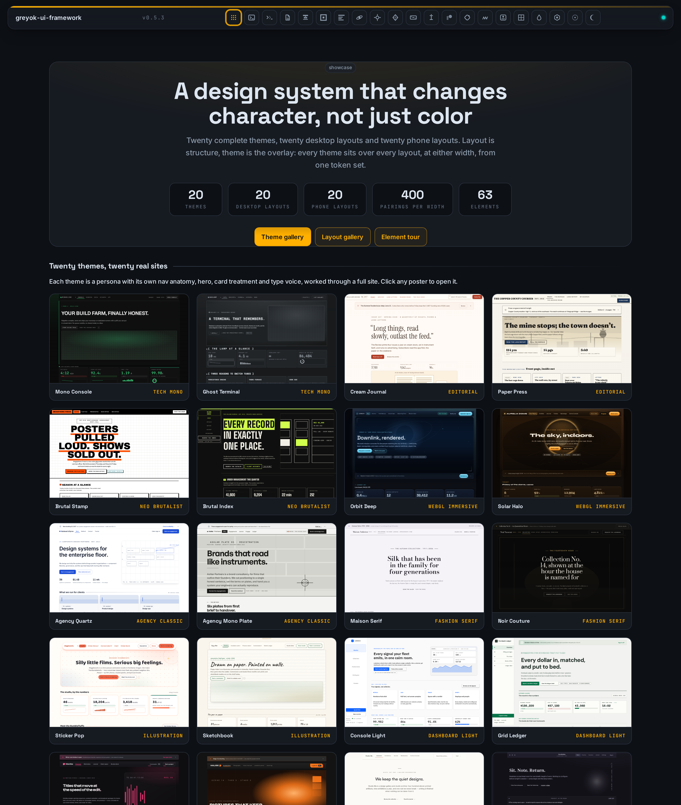
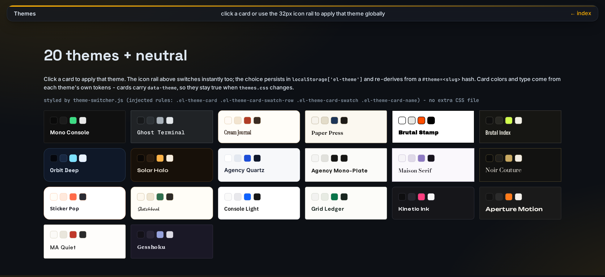
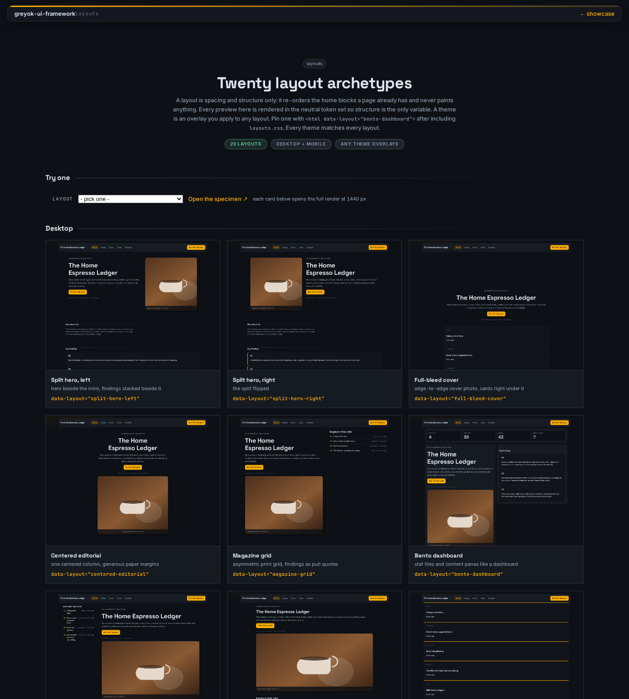
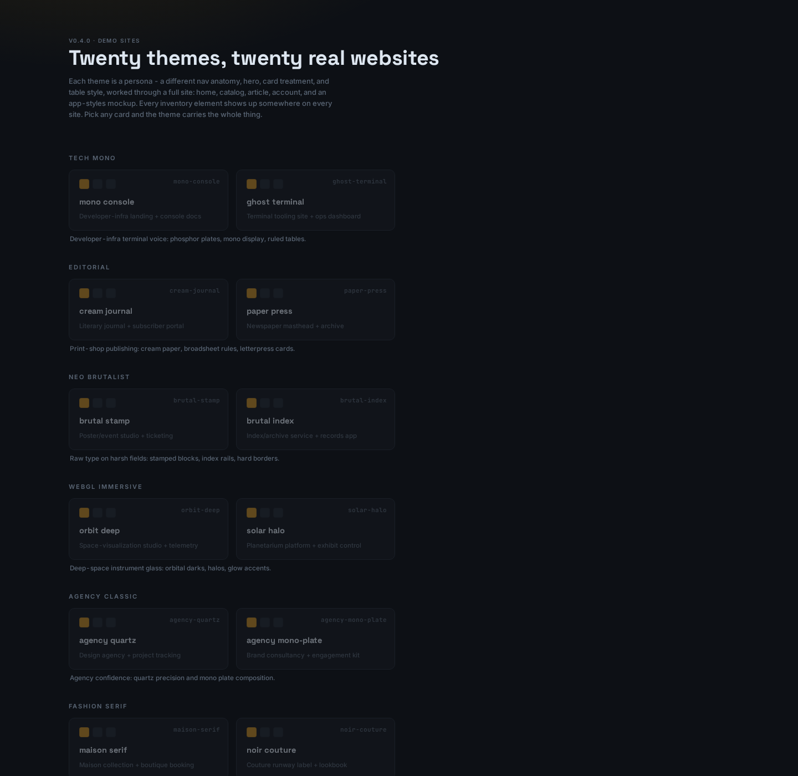

<div align="center">


# greyok-ui-framework

**A dependency-free CSS and JavaScript design system: 20 themes, 20 layout archetypes and 63 elements.**

Structure and character are independent — every theme matches every layout. The same tokens work in HTML, TypeScript and Python/Tkinter.

[](package.json)
[](LICENSE)
[](base.css)
[](https://greyok00.github.io/greyok-ui-framework/demo/)

[Overview](#overview) · [Screenshots](#screenshots) · [Quick start](#quick-start) · [How it works](#how-it-works) · [Demo](#demo) · [License](#license)

</div>

---

## Overview

greyok-ui-framework is a design system you copy into a project. There is no
package runtime, no build step and no JavaScript dependency: every visual is
plain CSS delivered as cascade-layered stylesheets, and the optional JavaScript
files attach behavior to markup through `data-*` attributes and `.el-*`
classes. The same theme tokens are readable from TypeScript and from a
Python/Tkinter bridge that parses the CSS variables directly.

| Layer | What you get |
|---|---|
| **Themes** | 20 swappable themes plus `neutral`, applied with `[data-theme="…"]` |
| **Layouts** | 20 structural archetypes applied with `[data-layout="…"]` |
| **Elements** | 63 elements and about 300 classes across 16 cascade-layered sheets |
| **Sizes** | Six buckets: `xs`, `sm`, `md`, `lg`, `full`, `tray` |
| **Tokens** | About 55 CSS variables covering color, type, space, radius, shadow and motion |
| **Charts** | Dependency-free SVG charts: Sparkline, Bar, Line, Area and Donut |
| **Bridges** | TypeScript declarations and a Python/Tkinter theme bridge |

## Screenshots



The showcase is the product. Twenty themes are each worked through a complete
site — home, catalog, article, account and an app-style mockup — so the system
can be judged as a whole rather than as a pile of buttons.

| Theme gallery | Layout gallery |
| :---: | :---: |
|  |  |



## How it works

Three ideas keep the system composable:

1. **Tokens own the ink.** Each theme declares the complete token set. A theme
   never leaves a partial override behind.
2. **Layouts own the skeleton.** A layout re-orders blocks that already exist.
   It never paints and never depends on a specific theme.
3. **Cascade layers keep the peace.** Styles are split into `el-reset`,
   `el-tokens`, `el-elements` and `el-themes`. Element CSS never fights app CSS,
   and unlayered app styles always win.

Picking a theme or layout is one attribute:

```html
<html data-theme="grid-ledger" data-layout="sidebar-rail-nav">
```

## Quick start

### HTML / CSS

Copy the files into the project and include the layers in order: fonts, tokens,
themes, base, the element sheets you need, then layouts and scripts.

```html
<link rel="stylesheet" href="greyok-ui-framework/fonts.css">
<link rel="stylesheet" href="greyok-ui-framework/tokens.css">
<link rel="stylesheet" href="greyok-ui-framework/themes.css">
<link rel="stylesheet" href="greyok-ui-framework/base.css">
<link rel="stylesheet" href="greyok-ui-framework/elements-display.css">
<link rel="stylesheet" href="greyok-ui-framework/elements-structure.css">
<link rel="stylesheet" href="greyok-ui-framework/elements-lists.css">
<link rel="stylesheet" href="greyok-ui-framework/elements-controls.css">
<link rel="stylesheet" href="greyok-ui-framework/elements-inputs.css">
<link rel="stylesheet" href="greyok-ui-framework/elements-containers.css">
<link rel="stylesheet" href="greyok-ui-framework/elements-dataviz.css">
<link rel="stylesheet" href="greyok-ui-framework/elements-interactions.css">
<link rel="stylesheet" href="greyok-ui-framework/elements-misc.css">
<link rel="stylesheet" href="greyok-ui-framework/elements-app.css">
<link rel="stylesheet" href="greyok-ui-framework/elements-workflow.css">
<link rel="stylesheet" href="greyok-ui-framework/elements-reader.css">
<link rel="stylesheet" href="greyok-ui-framework/elements-assistant.css">
<link rel="stylesheet" href="greyok-ui-framework/elements-inspector.css">
<link rel="stylesheet" href="greyok-ui-framework/elements-overlay.css">
<link rel="stylesheet" href="greyok-ui-framework/elements-size.css">
<link rel="stylesheet" href="greyok-ui-framework/layouts.css">
<script src="greyok-ui-framework/theme-switcher.js" defer></script>
<script src="greyok-ui-framework/elements.js" defer></script>
```

### npm

```bash
npm install greyok-ui-framework
```

Import any CSS file by name (`greyok-ui-framework/tokens.css`,
`greyok-ui-framework/layouts.css`, and so on). The package `exports` map covers
every file.

### Python / Tkinter

```python
from greyok_ui_framework import ElTheme, ElWidget, get_theme

theme = get_theme("grid-ledger")
btn = ElWidget(parent, "btn", theme=theme, text="Run", command=handler)
btn.pack()

print(f"bg={theme.bg}  accent={theme.accent}  live={theme.live}")
```

### TypeScript

```typescript
import "greyok-ui-framework/typescript/elements.d.ts";

const pill = document.querySelector(".el-pill.ok") as HTMLSpanElement;
const tabs = document.querySelector(".el-tabs-h") as HTMLDivElement;
```

## The twenty themes

Themes are grouped into ten families, two skins each:

| Family | Themes |
|---|---|
| tech-mono | `mono-console`, `ghost-terminal` |
| editorial | `cream-journal`, `paper-press` |
| neo-brutalist | `brutal-stamp`, `brutal-index` |
| webgl-immersive | `orbit-deep`, `solar-halo` |
| agency-classic | `agency-quartz`, `agency-mono-plate` |
| fashion-serif | `maison-serif`, `noir-couture` |
| illustration | `sticker-pop`, `sketchbook` |
| dashboard-light | `console-light`, `grid-ledger` |
| motion-brand | `kinetic-ink`, `aperture-motion` |
| quiet-minimal | `ma-quiet`, `gesshoku` |

Plus `neutral` — graphite and amber — as the default in `tokens.css`.

## The twenty layouts

Layouts are structure only. They re-order the home blocks a page already has —
hero, intro, findings, stats, contents, cards, disclaimer — and never paint.
Pin one with an attribute:

```html
<link rel="stylesheet" href="layouts.css">
<html data-layout="bento-dashboard" data-theme="mono-console">
```

| Slug | Structure |
|---|---|
| `split-hero-left` / `split-hero-right` | Hero beside the intro, findings stacked beside it |
| `full-bleed-cover` | Edge-to-edge cover, cards underneath |
| `centered-editorial` | One centered column with paper margins |
| `magazine-grid` | Asymmetric print grid |
| `bento-dashboard` | Stat tiles and content panes |
| `sidebar-rail-nav` | Navigation rail first, content beside it |
| `top-tab-console` | Tab console across the top |
| `kanban-board` | Content lanes as a board |
| `catalog-aisle-rows` | One row per piece |
| `pricing-columns` | Columns that read like a table of offers |
| `masonry-gallery` | Staggered card wall |
| `timeline-vertical` | Dated vertical spine |
| `terminal-shell` | Stat readout on top of a shell frame |
| `boxed-frame` | Everything inside a page border |
| `overlapping-panels` | Cards overlap the hero |
| `carousel-storefront` | Shopfront rhythm under the hero |
| `sticky-index` | Index pinned while content scrolls |
| `atlas-map-first` | Stat atlas up top, detail below |
| `single-column-zen` | One quiet column |

The layout sheet expects the page body in `main.el-main` and cards in
`.el-card-grid`; both are defined in `layouts.css`.

## Demo

The full demo runs without a build step:

```bash
python3 -m http.server 8768 --bind 127.0.0.1
# open http://127.0.0.1:8768/demo/
```

The live version is at
[greyok00.github.io/greyok-ui-framework/demo/](https://greyok00.github.io/greyok-ui-framework/demo/).

`demo/index.html` is the theme wall and layout picker; `themes.html`,
`layouts.html` and `elements.html` are the galleries; `demo/sites/` contains
the twenty persona sites, five pages each.

## Development

```bash
./bin/verify.sh                  # release checks: balance, roster, coverage, layers
python3 tools/build_themes.py    # themes/src/* -> themes.css
python3 tools/build_layouts.py   # layout kits -> layouts.css
python3 tools/render_shots.py    # posters and README screenshots
python3 -m pytest tests/
```

`themes.css` and `layouts.css` are generated artifacts: edit the sources,
rebuild, and commit both. The palette in `tokens.css` is frozen and enforced by
`bin/verify.sh`.

## Project layout

```text
greyok-ui-framework/
├── tokens.css               # neutral defaults, ~55 variables
├── themes.css               # 20 themes plus neutral
├── themes/src/              # ten readable family sources
├── layouts.css              # 20 structural archetypes
├── base.css                 # reset, focus ring, scrollbar
├── elements-*.css           # 16 cascade-layered element sheets
├── elements.js              # interaction wiring
├── charts.js                # SVG chart primitives
├── theme-switcher.js        # localStorage + URL hash theme bridge
├── python/                  # Tkinter bridge
├── typescript/              # declarations
├── demo/                    # showcase, galleries, persona sites
└── tests/                   # pytest suite
```

## License

Apache License 2.0 © [greyok00](https://github.com/greyok00). See [LICENSE](LICENSE).
Third-party typefaces are self-hosted under their own licenses; see
[fonts/LICENSES.md](fonts/LICENSES.md).
