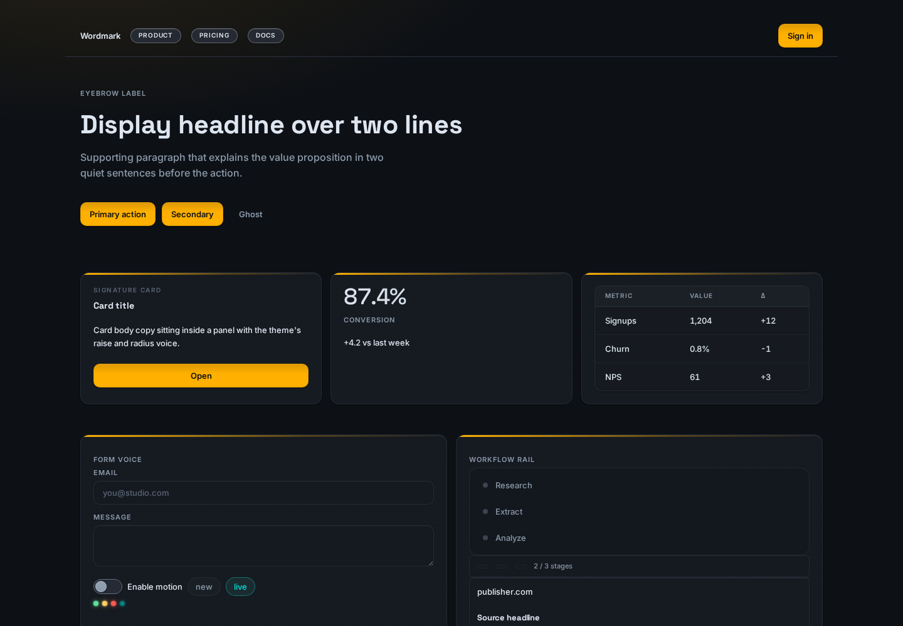

<div align="center">

# greyok-ui-framework

**Dependency-free CSS + JS design system: 100+ primitives, 20 themes, SVG charts, @layer tokens.**

[](LICENSE)
[](package.json)
[](https://greyok00.github.io/greyok-ui-framework/)


</div>

## What is it?

greyok-ui-framework is a design system you copy into a project. There is no
package runtime, no build step, and no JavaScript dependency: every visual is
plain CSS delivered as cascade-layered stylesheets, and the optional JS files
attach behavior to markup through `data-*` attributes and `.el-*` classes. The
same theme tokens are readable from TypeScript (element declarations) and
Python/Tkinter (a bridge that parses the CSS variables directly).

To use it, copy the files and include the layers in order in your `<head>`:
fonts first, then tokens, themes, base, then the element sheets you need, then
the scripts. Picking a theme means setting `data-theme="slug"` on `<html>`;
every theme declares a complete token set so components re-skin instantly.

| File group | Purpose |
|---|---|
| `tokens.css` | Neutral theme: ~55 custom properties (color, type, space, radius, shadow, motion) |
| `themes.css` | Generated `[data-theme]` blocks for the 20-theme roster (see Themes) |
| `fonts.css` | `@font-face` rules for the self-hosted woff2 files under `fonts/` |
| `base.css` | Reset, focus-visible law, scrollbar, and the cascade layer declarations |
| `elements-*.css` | 16 element sheets (display, lists, controls, inputs, containers, dataviz, and more), each wrapped in `@layer el-elements` |
| `elements.js` | Behavior wiring: tabs, toggles, menus, dialogs, drawers, command palette, toasts, keyboard support |
| `charts.js` | Dependency-free SVG charts: Sparkline, Bar, Line, Area, Donut |
| `theme-switcher.js` | Applies `[data-theme]`, persists the choice, renders a switcher strip |
| `elements-workflow.js` | Stage rail, inspector, and assistant plan helpers |
| `python/`, `typescript/` | Tkinter bridge (CSS variables to `ElTheme`) and element interface declarations |

## Screenshots

The pages below ship in `demo/` and open directly in a browser, offline.

<div align="center">

**Element demo — every component on one page**


**Theme harness — inspect one theme at a time**



**Twenty persona sites — full pages built from the same tokens**


**Responsive from phones up**


</div>

## Use

A minimal page; the same include order every demo page uses.

```html
<!doctype html>
<html lang="en" data-theme="mono-console">
<head>
  <meta charset="utf-8">
  <link rel="stylesheet" href="fonts.css">
  <link rel="stylesheet" href="tokens.css">
  <link rel="stylesheet" href="themes.css">
  <link rel="stylesheet" href="base.css">
  <link rel="stylesheet" href="elements-display.css">
  <script src="theme-switcher.js" defer></script>
  <script src="elements.js" defer></script>
</head>
<body>
  <span class="el-pill ok">live</span>
  <button class="el-btn">Run</button>
  <div data-theme-strip></div>
</body>
</html>
```

Serve the directory statically (`python3 -m http.server`) and open the page.
`demo/` contains one page per element category plus `demo/themes.html` with a
preview card per theme, all working offline against the same files. The
online copy of the same tree is the
[live demo](https://greyok00.github.io/greyok-ui-framework/).

## Themes

`themes.css` is a generated artifact, not hand-written CSS. Each theme family
is authored in `themes/src/<family>.css` (two themes per family file) and
assembled by `tools/build_themes.py`, which verifies token completeness and
brace balance, then wraps the result in `@layer el-themes`. Rebuild it after
editing a source file:

```bash
python3 tools/build_themes.py            # readable build (committed at the root)
python3 tools/build_themes.py --minified # collapsed form for dist packaging
```

`fonts.css` is generated the same way by `tools/fetch_fonts.py` from the
rostered faces in `fonts/`; the bundled typefaces are listed with their
licenses in `fonts/LICENSES.md`. Element CSS is never
hand-minified: the root stylesheets are readable, and minification belongs to
dist workflows only (`tools/minify.py`).

## Development

Built with AI assistance and verified by tests and CI: the pytest suite under
`tests/` checks token declarations, theme roster coverage, TypeScript
regeneration, and CSS wiring, and `bin/verify.sh` runs the release checks
(brace balance, palette freeze, JS syntax, demo class coverage, icon sprite).

## License

Apache License 2.0, see [LICENSE](LICENSE). The 28 bundled font families ship
under their own licenses (24 under SIL OFL 1.1, 4 from Fontshare under the ITF
Free Font License); the full per-family list is in `fonts/LICENSES.md`.
