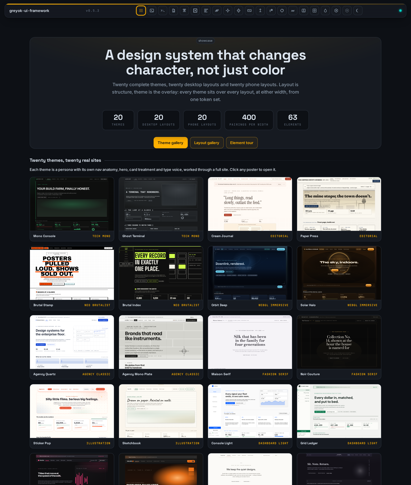
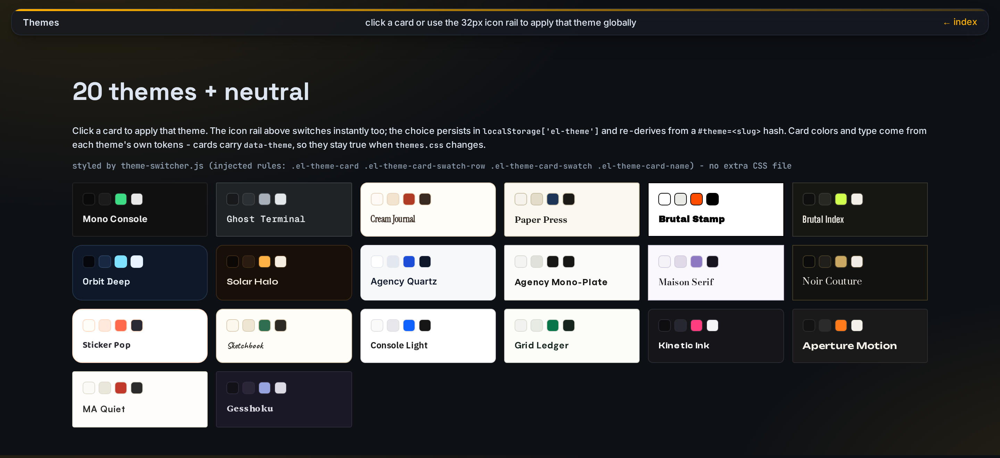
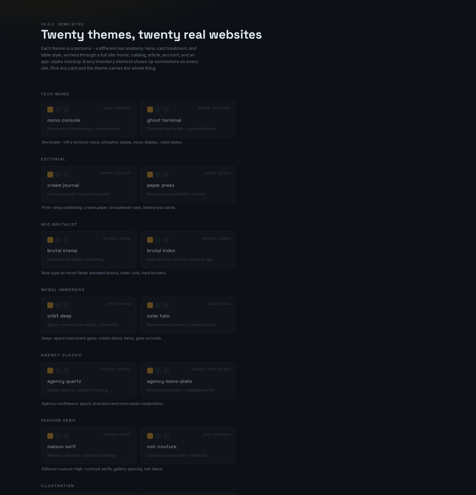
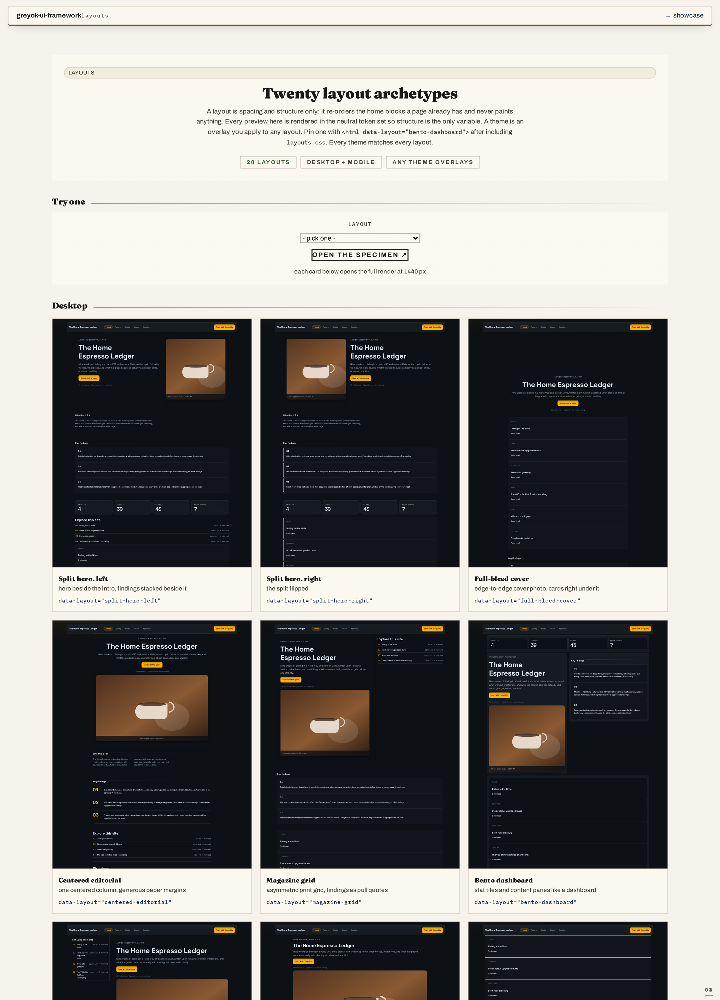
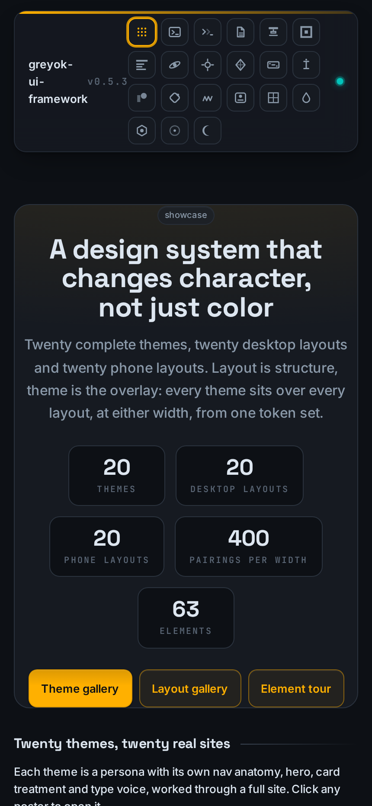
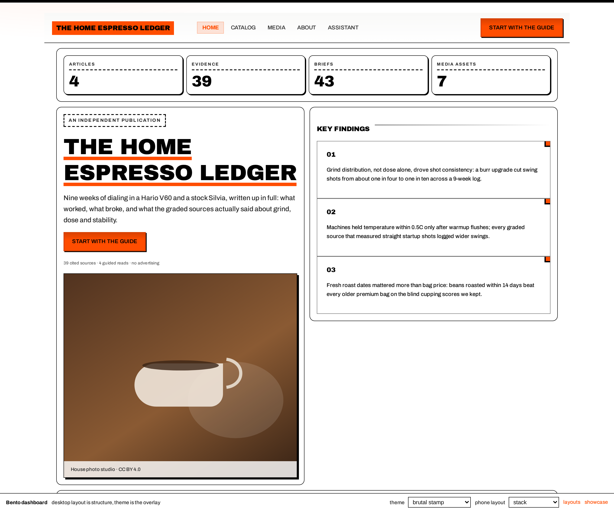
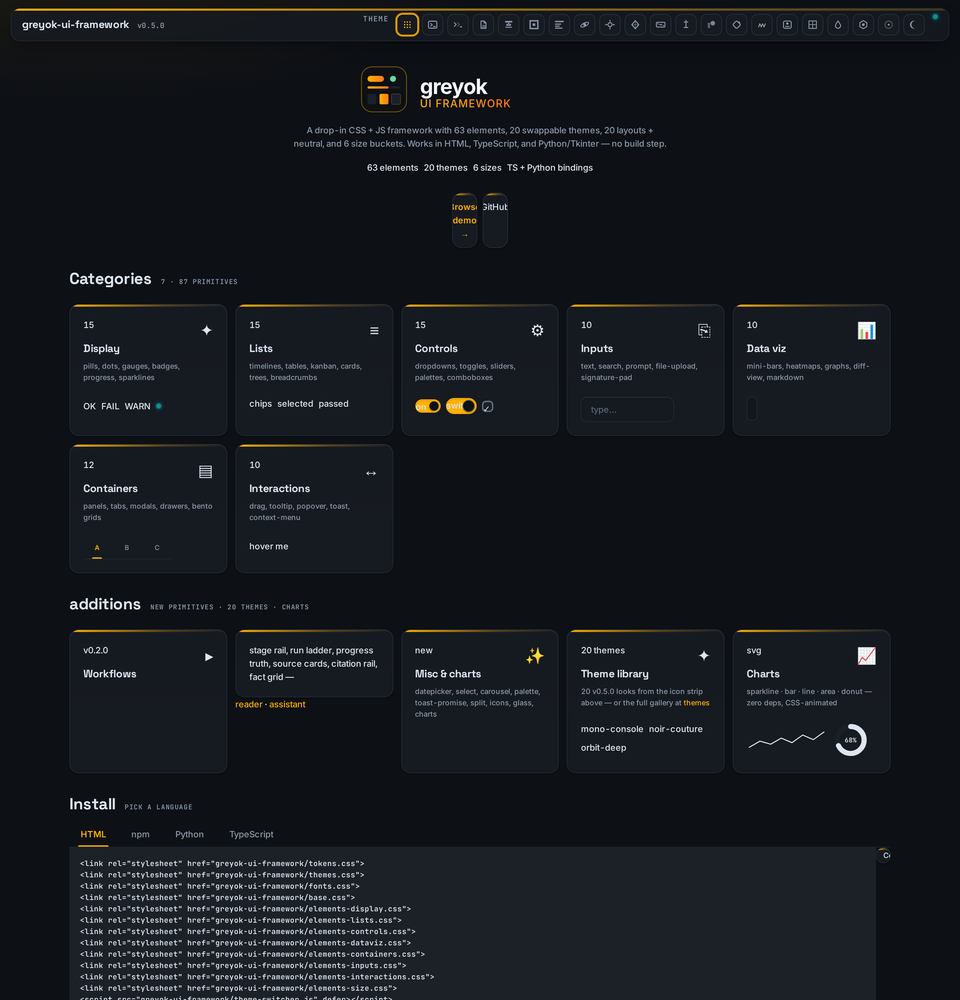

<p align="center">
  
</p>

<p align="center">
  <strong>A dependency-free CSS + JS design system: 20 themes, 20 desktop layouts, 20 phone layouts, 63 evidence-backed elements.</strong>
  <br><br>
  Structure and character are independent - any theme overlays any layout, at either width. Works in HTML, TypeScript, and Python/Tkinter.
  <br><br>
  <a href="https://greyok00.github.io/greyok-ui-framework/demo/"></a>
  <a href="https://github.com/greyok00/greyok-ui-framework"></a>
  <a href="https://github.com/greyok00/greyok-ui-framework"></a>
  <a href="https://github.com/greyok00/greyok-ui-framework"></a>
</p>

<p align="center">
  
</p>

<p align="center"><em>The showcase. Hero counts, then the wall: every poster is a real multi-page site on that theme.</em></p>

---

## 👀 See it live

**[→ greyok00.github.io/greyok-ui-framework/demo/](https://greyok00.github.io/greyok-ui-framework/demo/)**

No install, no build. The front door opens on the theme wall; the layout gallery re-shuffles the same content into twenty desktop and twenty phone structures. Every card clicks through to a working page.

| | |
|---|---|
| 🪟 Showcase | [demo/index.html](https://greyok00.github.io/greyok-ui-framework/demo/) - 20-theme poster wall + layout picker |
| 🎨 Theme gallery | [demo/themes.html](https://greyok00.github.io/greyok-ui-framework/demo/themes.html) - every theme as a swatch card, click to re-skin the page |
| 📐 Layout gallery | [demo/layouts.html](https://greyok00.github.io/greyok-ui-framework/demo/layouts.html) - 20 desktop and 20 phone structures, live and rendered |
| 🌐 Persona sites | [demo/sites/index.html](https://greyok00.github.io/greyok-ui-framework/demo/sites/index.html) - the 20 sites, grouped by family |
| 🧩 Element tour | [demo/elements.html](https://greyok00.github.io/greyok-ui-framework/demo/elements.html) - the 63-element inventory on one page |

---

## 🖼 The showcase

The showcase is the product. Twenty themes, each worked through a complete site - home, catalog, article, account, and an app-styles mockup - so you can judge the system as a whole rather than as a pile of buttons. The screenshots below are renders of the actual pages, not mockups.

<p align="center">
  
</p>

<p align="center"><em>The theme gallery. Click a card and the whole page re-skins instantly; every theme declares the full token set.</em></p>

<p align="center">
  
</p>

<p align="center"><em>The roster, grouped by family. Each entry is a real site with its own nav anatomy, hero, card treatment and type voice.</em></p>

### The twenty themes

Every theme applies through `[data-theme="<slug>"]` on `<html>`. Each source family carries two skins, so the roster reads coherently while each persona keeps its own voice.

| Family | Themes | Character |
|---|---|---|
| tech-mono | `mono-console`, `ghost-terminal` | terminal chrome, phosphor plates, ruled tables |
| editorial | `cream-journal`, `paper-press` | print shop: cream paper, broadsheet rules, letterpress |
| neo-brutalist | `brutal-stamp`, `brutal-index` | raw type on harsh fields, stamped blocks |
| webgl-immersive | `orbit-deep`, `solar-halo` | deep-space instrument glass, halos, glow |
| agency-classic | `agency-quartz`, `agency-mono-plate` | quartz precision and mono plate composition |
| fashion-serif | `maison-serif`, `noir-couture` | high-contrast serifs, gallery spacing, noir |
| illustration | `sticker-pop`, `sketchbook` | pop sticker edges, warm sketchbook grain |
| dashboard-light | `console-light`, `grid-ledger` | light chrome, data density, ledger precision |
| motion-brand | `kinetic-ink`, `aperture-motion` | ink sweeps, shutter frames, kinetic underlines |
| quiet-minimal | `ma-quiet`, `gesshoku` | ma spacing, hairline calm, composed applets |

Plus `neutral` - graphite and amber - which lives in `tokens.css` as the default.

## 📐 The twenty layouts

A layout is **spacing and structure only**. It re-orders the home blocks a page already has - hero, intro, findings, stats, contents, cards, disclaimer - and never paints anything: no colors, no type, no imagery. A theme is the paint. The two are independent, so **any theme overlays any layout**, at either width.

There are two layout axes, authored separately:

| Axis | Attribute | Count | When it applies |
|---|---|---|---|
| Desktop layouts | `data-layout="<slug>"` | 20 | 701 px and up |
| Phone layouts | `data-layout-mobile="<slug>"` | 20 | 700 px and down |

The phone layouts are dedicated structures, not the desktop kits collapsed. The counts multiply: 20 themes over 20 desktop layouts makes 400 possible desktop combinations, and the same 20 themes over 20 phone layouts makes 400 possible phone combinations. Only 60 things are authored: 20 themes, 20 desktop layouts, 20 phone layouts.

Every preview below is rendered in the neutral token set, so the only thing that changes between two cards is the structure.

<p align="center">
  
</p>

<p align="center"><em>The layout gallery. Desktop structures first, each rendered in neutral so structure is the only variable, then the twenty phone structures.</em></p>

The twenty phone structures are: stack, bottom tabs, sticky header, full cover, stats first, two-up, carousel, swipe lanes, list rows, timeline, chip index, media first, hero band, pricing stack, masonry two-column, boxed, overlap, zen, atlas, and scroll sections.

<p align="center">
  
</p>

<p align="center"><em>The same showcase at 430 px. The phone axis is chosen separately from the desktop axis.</em></p>

<p align="center">
  
</p>

<p align="center"><em>One layout, one theme overlaid. The block grid is identical; only the paint changed.</em></p>

Each layout ships as a **live page** under `demo/layouts/<slug>.html`. It opens neutral and takes any theme and any phone layout as overlays, from the selectors on the page or from the URL:

```
demo/layouts/bento-dashboard.html?theme=brutal-stamp&mobile=m-carousel
```

`tools/check_matrix.py` proves the matrix: for all 400 desktop pairings and all 400 phone pairings it renders the page, checks there is no horizontal overflow and no page error, and checks that changing the theme leaves the structural properties (display mode, grid tracks, child placement) identical. It also fingerprints each layout so two layouts that merely re-skin the same page are reported as duplicates.

Pin one with a single attribute:

```html
<link rel="stylesheet" href="layouts.css">
<html data-layout="bento-dashboard" data-theme="grid-ledger">
```

| Slug | Name | Structure |
|---|---|---|
| `split-hero-left` | Split hero, left | hero beside the intro, findings stacked beside it |
| `split-hero-right` | Split hero, right | the split flipped |
| `full-bleed-cover` | Full-bleed cover | edge-to-edge cover photo, cards right under it |
| `centered-editorial` | Centered editorial | one centered column, generous paper margins |
| `magazine-grid` | Magazine grid | asymmetric print grid, findings as pull quotes |
| `bento-dashboard` | Bento dashboard | stat tiles and content panes like a dashboard |
| `sidebar-rail-nav` | Sidebar rail nav | navigation rail first, content beside it |
| `top-tab-console` | Top tab console | tab console across the top, panes beneath |
| `kanban-board` | Kanban board | content lanes laid out like a board |
| `catalog-aisle-rows` | Catalog aisle rows | one row per piece, aisle style |
| `pricing-columns` | Pricing columns | columns that read like a table of offers |
| `masonry-gallery` | Masonry gallery | a staggered gallery wall of cards |
| `timeline-vertical` | Timeline vertical | a dated vertical spine through the content |
| `terminal-shell` | Terminal shell | stat readout on top, content in a shell frame |
| `boxed-frame` | Boxed frame | everything framed inside a page border |
| `overlapping-panels` | Overlapping panels | cards overlap the hero like stacked prints |
| `carousel-storefront` | Carousel storefront | shopfront rhythm, cards sweep under the hero |
| `sticky-index` | Sticky index | the index pinned first, content scrolls beside it |
| `atlas-map-first` | Atlas map first | the stat atlas up top, detail below |
| `single-column-zen` | Single column zen | one quiet column, nothing decorative |

The layout sheet expects the page body in `main.el-main` and cards in `.el-card-grid`; both are defined in `layouts.css`, so nothing else is required.

---

## What is it?

greyok-ui-framework is a design system you copy into a project. There is no
package runtime, no build step, and no JavaScript dependency: every visual is
plain CSS delivered as cascade-layered stylesheets, and the optional JS files
attach behavior to markup through `data-*` attributes and `.el-*` classes. The
same theme tokens are readable from TypeScript (element declarations) and
Python/Tkinter (a bridge that parses the CSS variables directly).

To use it, copy the files and include the layers in order in your `<head>`:
fonts first, then tokens, themes, base, then the element sheets you need, then
`layouts.css` if you want the archetypes, then the scripts. Picking a theme
means setting `data-theme="slug"` on `<html>`; picking a layout means setting
`data-layout="slug"`. Every theme declares a complete token set, so components
re-skin instantly.

| File group | Purpose |
|---|---|
| `tokens.css` | Neutral theme: ~55 custom properties (color, type, space, radius, shadow, motion) |
| `themes.css` | Generated `[data-theme]` blocks for the 20-theme roster |
| `themes/src/` | Ten readable family sources (two themes per file) that build `themes.css` |
| `layouts.css` | The 20 `[data-layout]` archetypes; structure only |
| `fonts.css` | `@font-face` rules for the self-hosted woff2 files under `fonts/` |
| `base.css` | Reset, focus-visible law, scrollbar, and the cascade layer declarations |
| `elements-*.css` | 16 element sheets, each wrapped in `@layer el-elements` |
| `elements.js` | Behavior wiring: tabs, toggles, menus, dialogs, drawers, command palette, toasts, keyboard support |
| `charts.js` | Dependency-free SVG charts: Sparkline, Bar, Line, Area, Donut |
| `theme-switcher.js` | Applies `[data-theme]`, persists the choice, renders the 32 px icon strip |
| `elements-workflow.js` | Stage rail, inspector, and assistant plan helpers |
| `python/`, `typescript/` | Tkinter bridge (CSS variables to `ElTheme`) and element interface declarations |

## Install

<details>
<summary><strong>HTML / CSS</strong> - zero config</summary>

```html
<link rel="stylesheet" href="greyok-ui-framework/fonts.css">
<link rel="stylesheet" href="greyok-ui-framework/tokens.css">
<link rel="stylesheet" href="greyok-ui-framework/themes.css">
<link rel="stylesheet" href="greyok-ui-framework/base.css">
<link rel="stylesheet" href="greyok-ui-framework/elements-display.css">
<link rel="stylesheet" href="greyok-ui-framework/elements-structure.css">
<link rel="stylesheet" href="greyok-ui-framework/elements-lists.css">
<link rel="stylesheet" href="greyok-ui-framework/elements-controls.css">
<link rel="stylesheet" href="greyok-ui-framework/elements-inputs.css">
<link rel="stylesheet" href="greyok-ui-framework/elements-containers.css">
<link rel="stylesheet" href="greyok-ui-framework/elements-dataviz.css">
<link rel="stylesheet" href="greyok-ui-framework/elements-interactions.css">
<link rel="stylesheet" href="greyok-ui-framework/elements-misc.css">
<link rel="stylesheet" href="greyok-ui-framework/elements-app.css">
<link rel="stylesheet" href="greyok-ui-framework/elements-workflow.css">
<link rel="stylesheet" href="greyok-ui-framework/elements-reader.css">
<link rel="stylesheet" href="greyok-ui-framework/elements-assistant.css">
<link rel="stylesheet" href="greyok-ui-framework/elements-inspector.css">
<link rel="stylesheet" href="greyok-ui-framework/elements-overlay.css">
<link rel="stylesheet" href="greyok-ui-framework/elements-size.css">
<link rel="stylesheet" href="greyok-ui-framework/layouts.css">
<script src="greyok-ui-framework/theme-switcher.js" defer></script>
<script src="greyok-ui-framework/elements.js" defer></script>
```

Pick a theme and, optionally, a layout:

```html
<html data-theme="grid-ledger" data-layout="sidebar-rail-nav">
```

That is the whole API.
</details>

<details>
<summary><strong>npm</strong></summary>

```bash
npm install greyok-ui-framework
```

Then import the CSS by name (`greyok-ui-framework/tokens.css`, `greyok-ui-framework/layouts.css`, etc.) - the package.json `exports` map covers every file.
</details>

<details>
<summary><strong>Python / Tkinter</strong></summary>

```python
from greyok_ui_framework import ElTheme, ElWidget, get_theme

theme = get_theme("grid-ledger")            # any of 20 themes
btn = ElWidget(parent, "btn", theme=theme, text="Run", command=handler)
btn.pack()

# Or rely on the theme dataclass directly
print(f"bg={theme.bg}  accent={theme.accent}  live={theme.live}")
```
</details>

<details>
<summary><strong>TypeScript</strong></summary>

```typescript
import "greyok-ui-framework/typescript/elements.d.ts";

const pill = document.querySelector(".el-pill.ok") as HTMLSpanElement;
const tabs = document.querySelector(".el-tabs-h") as HTMLDivElement;
```
</details>

## Theme switcher

`theme-switcher.js` reads `localStorage['el-theme']` first, falls back to URL hash `#theme=mono-console`, then defaults to `neutral`. It auto-renders a 32 px icon strip (one hand-drawn SVG glyph per theme) into any `[data-theme-strip]` container - tiles are `role="radiogroup"` buttons with arrow-key cycling, and all strip styling is injected by the script, so no extra CSS file is needed.

```html
<div id="el-theme-strip" data-theme-strip></div>
<script src="greyok-ui-framework/theme-switcher.js" defer></script>
```

## Features

| Layer | What you get |
|---|---|
| **Showcase** | 20 complete persona sites and a layout picker in `demo/`, plus 20 full-page posters used on this page and in the demo wall |
| **Themes** | 20 swappable themes + `neutral` via `[data-theme="…"]`, built from ten readable family sources. Switcher persists to `localStorage` + URL hash and ships a 32 px icon strip |
| **Layouts** | 20 archetypes via `[data-layout="…"]` in one 18 KB sheet - structure only, so every theme matches every layout |
| **Elements** | 63 evidence-backed elements (~300 shipped classes) across 16 cascade-layered sheets - Display, Structure, Lists, Controls, Inputs, Containers, Dataviz, Interactions, Misc, App chrome, Workflow, Reader, Assistant, Inspector, Overlay, Size |
| **Sizes** | 6 buckets - `xs` (48 px) / `sm` (50 × 200) / `md` / `lg` (1200 × 400) / `full` (1200 × 800) / `tray` (720 × 420) |
| **Tokens** | ~55 CSS variables - color, type, space, radius, shadow, motion |
| **Stubs** | ~40 wire functions in `elements.js` - signature-pad draw, waveform seek/play, file-upload drop, code-block copy, kbd-input capture, palette arrow-nav, tabs keyboard, modal/drawer esc-close, clipboard, … |
| **Charts** | `charts.js` - dependency-free SVG primitives: `Sparkline`, `Bar`, `Line`, `Area`, `Donut`, with `<title>` tooltips and reduced-motion-aware animation |
| **Architecture** | Single `@layer` cascade (`el-reset` / `el-tokens` / `el-elements` / `el-themes`) - element CSS never fights app CSS, and unlayered app styles always win |
| **Tooling** | `bin/verify.sh` release checks · `tools/build_themes.py` assembles `themes.css` from family sources · `tools/build_layouts.py` assembles `layouts.css` · `tools/render_shots.py` renders posters and README screenshots · pytest suite in `tests/` |
| **Bridges** | TypeScript declarations and a Python/Tkinter bridge (`greyok_ui_framework.py` parses CSS into an `ElTheme` dataclass) |

## Sizes

| Token | Affordance | Use |
|---|---|---|
| `.el--xs` | 48 px | icon button, status dot |
| `.el--sm` | 50 × 200 | vertical tray popup |
| `.el--md` | fluid | default |
| `.el--lg` | 1200 × 400 | wide-short banner |
| `.el--full` | 1200 × 800 | desktop |
| `.el--tray` | 720 × 420 | popup-shaped wrapper |

Apply directly on any element: `<span class="el-pill el--xs">…</span>`

## Element categories

<p align="center">
  
</p>

<p align="center"><em>The element tour, secondary to the showcase: all 63 elements on one page, in whatever theme is active.</em></p>


The element set is the supporting cast, not the pitch - but it is what the themes are made of, and every persona site uses all 63.

| Category | Count | Examples |
|---|---|---|
| **Display** | 15 | pill, dot, big-num, gauge, sparkline, barograph, kbd, badge, avatar, progress, skeleton, spinner, rating, swatch, empty |
| **Lists** | 15 | timeline (h/v), accordion, kanban, table, card, hover-card, chip, tree-list, breadcrumb, pagination, def-list, task-list, stepper |
| **Controls** | 15 | dropdown, check, toggle, switch, slider, range, segmented, search, palette, combobox, multi-select, dropdown-menu, context-menu, radio |
| **Data viz** | 10 | mini-bar, mini-line, entity-graph, treemap, sparkline, heatmap, scatter, sankey-stub, diff-view, markdown |
| **Containers** | 12 | panel, tabs (h/v/pill), modal, drawer, bento, split, sticky-*, masonry, scroll-shadow, toast-region |
| **Inputs** | 10 | input, textarea, search-bar, prompt, file-upload, swatch-input, signature-pad, audio-waveform, code-block, kbd-input |
| **Interactions** | 10 | drag/drop, drop-zone, hover-detail, tooltip, popover, context-menu, toast, infinite-trigger, anchor-nav |
| **Misc** | 9 | datepicker, select, carousel, command palette, split-resizable, bottom-bar, glass, skeleton→content, icon sprite + SPA view transitions |
| **Charts** | 5 | sparkline, bar, line, area, donut (SVG, `charts.js`) |

## Demo pages

```bash
python3 -m http.server 8768 --bind 127.0.0.1
# open http://127.0.0.1:8768/demo/
```

```
demo/
├── index.html          ← showcase: 20-theme poster wall + layout picker (live)
├── themes.html         ← 25 theme cards, click to re-skin the page
├── layouts.html        ← 20 desktop + 20 phone structures
├── layouts/            ← 20 live layout pages: any theme and any phone overlay
├── elements.html       ← the 63-element inventory + install snippets
├── display.html … sizes.html   ← one page per element category
├── posters/            ← full-page renders of all 20 persona sites
├── layout-previews/    ← 20 desktop renders (1440 × 860)
├── layout-previews-mobile/ ← 20 mobile renders (390 × 844)
└── sites/              ← the 20 persona sites, five pages each
```

## Project layout

```
greyok-ui-framework/
├── tokens.css               # ~55 CSS vars (neutral defaults)
├── themes.css               # 25 [data-theme] blocks, built from themes/src/*
├── themes/src/              # 10 readable family sources
├── layouts.css              # 20 [data-layout] archetypes (structure only)
├── base.css                 # reset, focus ring, scrollbar, demo bar
├── elements-*.css           # 16 cascade-layered element sheets
├── elements.js              # ~45 wire functions (interactive stubs)
├── charts.js                # SVG chart primitives
├── theme-switcher.js        # localStorage + URL hash bridge, 20-theme strip
├── bin/verify.sh            # release checks (balance, roster, coverage, layers)
├── tools/
│   ├── build_themes.py      # themes/src/* → themes.css
│   ├── build_layouts.py     # layout kits → layouts.css
│   ├── render_shots.py      # posters and README screenshots
│   ├── minify.py            # comment stripper / minifier
│   └── tokens-codegen.py    # design-tokens JSON → CSS custom properties
├── tests/                   # pytest: tokens, themes, icons, declarations
├── python/                  # Tkinter bridge - CSS → ElTheme dataclass
├── typescript/              # declarations for every el-* class + data-* attr
├── demo/                    # showcase, galleries, and 20 persona sites
├── assets/                  # wordmark, logo, icon sprite
├── package.json
├── LICENSE                  # Apache-2.0
└── README.md
```

## Conventions

- All element classes prefixed with `.el-*` (or `data-*` for behavior)
- All status colors via `--el-ok`, `--el-warn`, `--el-fail`, `--el-info`, `--el-live` (always distinct)
- Themes declare the **full** token set; never partial overrides
- Layouts declare **structure only**; never paint, never depend on a specific theme
- Zero `:root` overrides - themes only inherit through `[data-theme]` selectors
- **Palette freeze** - the core palette in `tokens.css` is frozen; `bin/verify.sh` enforces it against git HEAD
- `themes.css` and `layouts.css` are generated artifacts: edit the sources, rebuild, commit both

## Run the demo

```bash
cd greyok-ui-framework
python3 -m http.server 8768 --bind 127.0.0.1
# open http://127.0.0.1:8768/demo/
```

## License

Apache License 2.0 © [greyok00](https://github.com/greyok00) - see [LICENSE](LICENSE).
Third-party typefaces are self-hosted under their own licenses; see [fonts/LICENSES.md](fonts/LICENSES.md).
